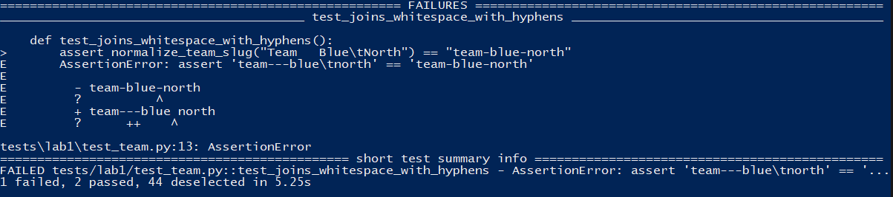

# Rapport individuel — Fadiiiiiiiiiiiii

## Organisation et rôle

Le projet a été réalisé avec `richardmilles`, `Lorenzece` et `Jeereemyy`. J'ai principalement travaillé avec `richardmilles` sur les cas limites du Lab 1 et sur les contrats de validation des données. Ma responsabilité principale dans le Lab 2 portait sur les domaines de valeurs, la détection des données impossibles et la conception de la faute B.

## Contribution au Lab 1

J'ai analysé les différentes entrées possibles de `normalize_team_slug` : espaces au début ou à la fin, plusieurs séparateurs consécutifs, tabulations, retours à la ligne et chaîne entièrement blanche. J'ai participé à la définition d'un test supplémentaire utilisant uniquement des tabulations et retours à la ligne. Ce test évite qu'une implémentation limitée au remplacement des espaces ordinaires soit considérée comme correcte.

J'ai vérifié le comportement avant et après la correction. Avant la modification, le test reproduisait le défaut attendu. Après la modification, les suites de caractères blancs produisaient un seul tiret et les entrées sans mot étaient rejetées. J'ai aussi participé aux contrôles globaux pour vérifier l'absence de régression.

## Contribution au Lab 2 : validation

Ma contribution principale concernait `validate.py`. J'ai participé à la définition de plusieurs familles de contraintes : colonnes obligatoires, absence de valeurs manquantes, types numériques, identifiants positifs et uniques, domaines catégoriels, variables normalisées, compteurs et fenêtre de dates.

Les variables catégorielles doivent être des entiers appartenant à leur domaine. `temp`, `atemp`, `hum` et `windspeed` doivent être finies et comprises entre 0 et 1. `casual`, `registered` et `cnt` doivent être des entiers non négatifs. Les dates doivent appartenir aux années 2011 et 2012. J'ai également vérifié que `instant` restait positif, entier et unique.

## Faute B et intégrité

J'ai participé à la création de `negative-registered.csv`, dans lequel une valeur de `registered` est remplacée par `-1`. Cette anomalie est isolée et représente un nombre impossible de locations. Le test associé vérifie le rejet du fichier fautif ainsi que l'acceptation d'un fichier de contrôle valide.

Nous avons choisi de rejeter la donnée plutôt que de la corriger silencieusement. Le validateur a accepté les 17 379 lignes du fichier original et confirmé que ses octets restaient inchangés. Son empreinte SHA-256 est `e03de4ee4ef4dc376ac6e04bf829673c6269e8eba5c60fa121640fa2f829504f`.

J'ai aussi contrôlé que les partitions de 8 645, 4 358 et 4 376 lignes totalisaient bien l'ensemble du fichier. La validation intervient avant le découpage, ce qui empêche une anomalie d'être masquée dans une partition particulière.

## Construction détaillée du contrat

J'ai séparé les règles selon leur nature. Les contrôles structurels vérifient les colonnes, ceux de complétude recherchent les valeurs manquantes, ceux de type empêchent une chaîne d'être utilisée comme mesure, et les contrôles sémantiques vérifient qu'une valeur numérique reste plausible. Cette distinction produit des erreurs plus faciles à diagnostiquer.

Une valeur `-1` dans `registered` est bien numérique, mais elle reste impossible du point de vue métier. À l'inverse, une chaîne dans cette colonne constitue d'abord une erreur de type. J'ai aussi porté attention aux valeurs `NaN` et infinies : elles peuvent traverser certains calculs puis contaminer les statistiques ou l'entraînement si elles ne sont pas rejetées explicitement.

Pour les catégories, vérifier seulement le type entier ne suffit pas. Une saison ou un mois peut être entier tout en étant hors du domaine prévu. Les ensembles de valeurs autorisées rendent le contrat lisible et empêchent l'acceptation de codes inconnus. Les plages `[0, 1]` des variables normalisées jouent un rôle similaire.

## Justification de la faute B

La faute devait être minimale afin de produire un diagnostic non ambigu. Modifier une seule valeur `registered` en `-1` conserve toutes les autres propriétés du fichier. Le test de contrôle est indispensable : sans lui, un validateur rejetant tous les fichiers réussirait le test négatif. Vérifier simultanément le rejet du défaut et l'acceptation du contrôle démontre un comportement réellement discriminant.

J'ai aussi vérifié que l'erreur identifiait la colonne concernée. Un message général comme « données invalides » serait peu utile pour corriger une source réelle. La mention de `registered` permet de localiser rapidement la règle violée.

## Effet sur le pipeline

La validation protège l'apprentissage. Des compteurs négatifs modifieraient la distribution de la cible et les métriques. Des valeurs normalisées hors intervalle signaleraient une transformation incorrecte. En présentant ces garanties au sous-groupe entraînement, j'ai vérifié que les hypothèses du modèle correspondaient bien au contrat des données.

La sortie `Validated 17379 rows; input bytes unchanged.` prouve à la fois l'acceptation de toutes les lignes et l'absence de correction silencieuse. L'empreinte SHA-256 complète cette preuve en identifiant précisément l'instantané utilisé.

## Tests et bilan

J'ai participé aux tests ciblés du validateur, à la faute B et à la suite complète de 49 tests. Ce travail m'a appris qu'un bon test de données doit vérifier à la fois un cas invalide précis et un contrôle valide. J'ai également compris l'intérêt de conserver l'entrée inchangée et de l'identifier par une empreinte reproductible.

Je retiens que la qualité des données doit être exprimée par des règles automatisées plutôt que par une inspection visuelle ponctuelle. Pour un futur lab, j'ajouterais des défauts minimaux pour chaque grande famille de contraintes en conservant des tests rapides et faciles à diagnostiquer.

## Captures et preuves

La sortie pytest montre le cas fautif reproduit avant la modification de la fonction.

Le message confirme l'acceptation des 17 379 lignes et l'absence de modification du fichier.

Cette vue rattache les données validées aux deux expériences comparées dans le rapport.

La PR regroupe les résultats du validateur, les tests et les vérifications du pipeline.

## Références

- Lab 1 : <https://github.com/Lorenzece/mlops-thu1-lfjn-bike-demand/pull/1>
- Lab 2 : <https://github.com/Lorenzece/mlops-thu1-lfjn-bike-demand/pull/2>
- Documentation : <https://github.com/Lorenzece/mlops-thu1-lfjn-bike-demand/pull/3>
