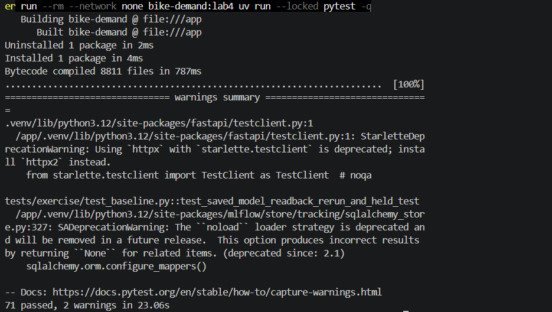
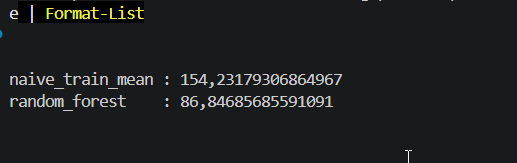

# Progress Report 1: Understanding the ML Workflow

## Overview
This report summarizes part of the team's progress on the MLOps project, with an emphasis on understanding the existing workflow and how its different components fit together. The aim was to follow the technical choices made during the project and keep a clear view of the overall process, rather than focus on a single assigned task.

## Work Discussed and Followed
The project was considered from an end-to-end perspective: starting with the input data, moving through preparation and model training, and ending with evaluation and the way results are organized. Particular attention was given to the connections between these stages and to why a consistent workflow matters when several people work on the same repository.
The main points covered were:
The overall structure of the repository and the purpose of its main components.
The relationship between data preparation, model training, and evaluation.
The importance of keeping configurations, dependencies, and results understandable.
The need for reproducible experiments so that the workflow can be reviewed and improved.

## Collaboration and Contribution
My participation was mainly part of the collective project follow-up: understanding the work in progress, taking part in discussions about the workflow, and helping maintain a shared understanding of the project's direction.

## Key Takeaways
An MLOps project is not limited to training a model. The organization of the code, clarity of the workflow, and ability to reproduce results are also important. Looking at the project as a whole helped connect the machine learning steps to the requirements of a more reliable and maintainable system.

## Next Steps
The next area of attention is how the existing workflow can be checked, documented, and prepared for more reliable execution.

## Testing and Validation
The project was validated through automated tests executed in a Docker environment. The test suite completed successfully with 71 passed tests and 2 warnings, providing additional confidence in the reliability of the implementation.

## Model Performance Comparison

A comparison was conducted between a naive baseline using the training mean and a Random Forest model. The results showed values of 154.23 for the naive baseline and 86.85 for the Random Forest.

These results highlight the difference between a simple baseline approach and a more advanced machine learning model, providing useful insights for evaluating the project's progress.

