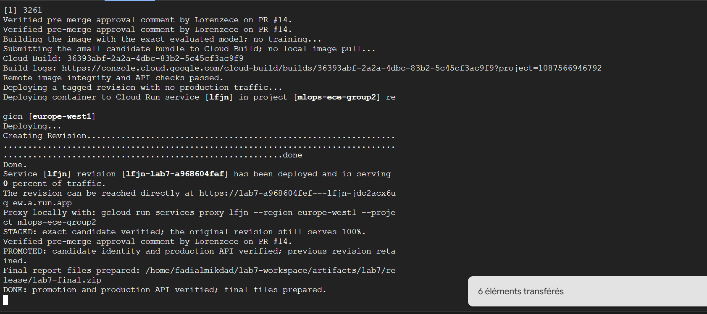

# Week 4 - Lab 7 contribution (Lab 8 pending)

## Student / team
Fadiiiiiiiiiiiii / LFJN, Thursday group 1.

## Links to code and pull requests
Implementation: https://github.com/Lorenzece/mlops-thu1-lfjn-bike-demand/pull/14.
Review: https://github.com/Lorenzece/mlops-thu1-lfjn-bike-demand/pull/14#issuecomment-6713794436.
Team evidence: https://github.com/Lorenzece/mlops-thu1-lfjn-bike-demand/tree/main/reports/lab7/evidence

## My contribution
I committed the policy and candidate pipeline, recovered the reference, ran the
checks and two trials, retained rejection/preservation evidence and performed
the manual release and production API verification.

## Decisions, execution and results
### Verified manual release and recovery

The pipeline and policy were reviewed in [PR #14](https://github.com/Lorenzece/mlops-thu1-lfjn-bike-demand/pull/14).
Lorenzece's pre-merge review comment and the recorded CI checks are retained in
the release evidence. Manual Cloud Shell preflight and Ruff checks passed;
pytest reported 115 passed, 32 subtests and two dependency warnings.

| Candidate | Validation MAE | Decision |
| --- | ---: | --- |
| 50 trees, depth 10 | 86.84685685591091 | ELIGIBLE |
| 25 trees, depth 1 | 116.16898107864859 | REJECTED |

The reference MAE was 86.84685685591091 and train-mean MAE was
154.23179306864967. The eligible result is equivalent, not an improvement.
Two candidate slots were used. No new candidate was trained for deployment.
The rejection preserved the original accepted bundle and serving identity.

An independent source-deploy trigger later deployed revision lfjn-00017-mzt
from the merge commit. That trigger was disabled. The previously verified
reference lfjn-00016-lz8 was deliberately restored and its API checked before
the evaluated candidate was manually promoted from reviewed main.

Release commit: `acb0d0687e740e98b4e795c3a7525578679d2d40`.
Model training commit: `c03eadb66a01ff3a46f7141656438a9d0aa1679c`.
Current served version: `candidate-20261107T123730Z-8ddcd4546383`.
Current Cloud Run revision: `lfjn-lab7-a968604fef`.
Current immutable image: `europe-west1-docker.pkg.dev/mlops-ece-group2/cloud-run-source-deploy/mlops-thu1-lfjn-bike-demand/lfjn@sha256:5b65857440f62ccb20c3d5904a8d525300963ee934aa7b88d134fbd7fb8b4f58`.
Exact model SHA-256: `de2ccb247c32ade78dcd7c43be6209ca03b7065de42fe8578c1b6e25f93482c3`.

The image was built and its exact-byte and API checks ran in Cloud Build;
no local Docker pull or deployment retraining was used. Tagged and production
API checks passed: ready health 200, valid prediction 200 with the expected
version, invalid input 422 and response request IDs. Production traffic is 100%.
The traffic switch uses an etag conflict check. These point-in-time observations
do not establish an HTTP latency or availability SLO.

Previous accepted revision `lfjn-00016-lz8` and its image remain available:
`europe-west1-docker.pkg.dev/mlops-ece-group2/cloud-run-source-deploy/mlops-thu1-lfjn-bike-demand/lfjn@sha256:9ddfa152a2f605fa1caa4f3354fd6f6658e21e57b19f1250ef56682c8436717b`. Its model version is `baseline-bd30b24b0a1d` and SHA-256 is `d24c050e3631d5b4c2feb8cb571bef6382d8c975c42a5c11edd28de78a0b8c07`.
Images retain the exact model, metadata and dependency environment for recovery
without retraining. Historical evaluation records remain unchanged. The initial
metadata's unavailable training commit and the slow initial health probes remain
documented limitations.

Before recovery, check the recorded current revision and coordinate one operator. Restore the previous accepted version without retraining:

`gcloud run services update-traffic lfjn --project mlops-ece-group2 --region europe-west1 --to-revisions lfjn-00016-lz8=100`

Then verify revision/image identity, ready health with version baseline-bd30b24b0a1d, valid prediction HTTP 200 and invalid-input HTTP 422. The full export and execution helpers remain in the retained Cloud Shell workspace. No Lab 8 incident drill is claimed here.

Release evidence: [promotion.json](https://github.com/Lorenzece/mlops-thu1-lfjn-bike-demand/blob/main/reports/lab7/evidence/promotion.json) and
[cloud-execution.json](https://github.com/Lorenzece/mlops-thu1-lfjn-bike-demand/blob/main/reports/lab7/evidence/cloud-execution.json).

## Review and response
Lorenzece's pre-merge review reports a passing corrupted-reference challenge.
Eligibility remains separate from deployment, and local latency from HTTP latency.

## Screenshots

Merged PR #14 at acb0d06. Review and detailed CI results are linked above.

Terminal evidence for lfjn-lab7-a968604fef: staging, promotion and production API verification.

## Learning

The work showed why a successful build, an eligible model and a verified promotion need separate evidence. The source-deploy trigger could change the served revision independently of GitHub Actions. Model, image and revision identities therefore need to be recorded together with fresh API checks.

## Blockers / missing evidence
Lab 8 and its incident/rollback drill are pending. This is the Lab 7 contribution
to the Week 4 report. Actual release evidence and retained versions are linked above.
